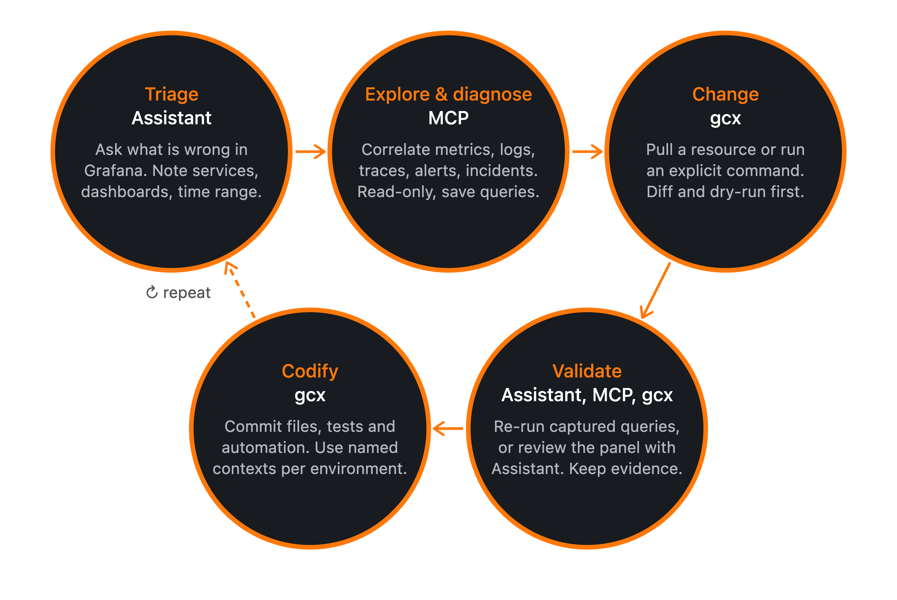

# Available AI tools in Grafana 

If you're a self-managed Grafana user, you have the following AI tools available to interact with Grafana:

**Grafana Assistant** is the Grafana AI agent, built into Grafana. Assistant brings a purpose-built LLM into Grafana so operators, developers, and SREs can troubleshoot issues, manage dashboards, and answer product questions in plain language. 

  - In self-managed Grafana the Assistant app runs in your own deployment but connects to a Grafana Cloud Assistant backend, with a reduced feature set. 
  - Some advanced features require the full Grafana Cloud feature set.
  - Assistant is billed per token consumed, including requests made through `gcx` and MCP servers (although Assistant in MCP is disabled by default). 

**MCP servers** let an external AI client (for example Claude, Cursor, or VS Code with Copilot) call Grafana as a set of tools that cover common tasks: dashboards and folders, data sources (Prometheus, Loki, and others), alerting, incidents, OnCall, and more.  

  - A model picks which tool to use based on the tool description, and calls the tool with structured arguments. Grafana runs it under normal identity and RBAC, and the structured result goes back to the model for its next step. 
  - Grafana offers two servers: Cloud MCP (hosted by Grafana) and OSS MCP (you run it).

**`gcx`** is an AI-native command-line tool that gives you or your AI agent structured access to Grafana (dashboards, folders, alert rules, data sources) and Grafana Cloud products such as Synthetic Monitoring, k6, Fleet Management, Incidents, and Adaptive Telemetry. You can script it to provide deterministic JSON or YAML output, defined errors, and predictable exit codes. Use it for scripts, CI, or GitOps. 

## Side-by-side comparison

This table summarizes the main points for each tool:

| | Grafana Assistant | Cloud MCP | OSS MCP | gcx |
|---|---|---|---|---|
|**What it is**| Built-in Grafana AI agent | Grafana-hosted MCP endpoint for external AI clients | Self-run MCP server (`mcp-grafana`) | CLI for Grafana and Grafana Cloud | 
|**Who drives it**| A person, inside Grafana | A person or an agent, through an MCP client | A person or an agent, through an MCP client | A person, a script, or a coding agent issuing explicit commands | 
|**Setup**| In Cloud, there's nothing to install, just enable it in your stack. Install the plugin for self-managed | Add one endpoint to a client; complete browser consent | Install and operate a server | Install the binary and configure contexts | 
|**Best for**| Specific questions, dashboards, investigations in the UI | Interactive diagnosis from your AI client with per-user permissions | Self-hosted, private networks, service identity, custom policy | Repeatable work, CI, GitOps, multi-stack changes | 
|**Cost note**| Per token consumed | Counts toward Assistant usage and active users | Server hosting is yours. Grafana usage rules apply | Free to use. Grafana usage rules apply. | 

## When to use each tool

See the following scenarios to better understand when to use each tool:

|I... | Use | Why? |
|---|---|---|
|Want an answer, a query, or a dashboard fast from the Grafana UI | Assistant | No setup, and Grafana manages context. |
|Want to allow an LLM to interact with my OSS Grafana instance | OSS MCP | It offers the deepest server-side tuning.| 
|Have CI pipelines, GitOps, dashboards as code, or work across several stacks | `gcx` | Explicit commands, exit codes, and named contexts make changes repeatable and reviewable.|
|Want conversational diagnosis followed by a reviewed change | MCP for diagnosis, `gcx` for the change | Refer to Use them together. | 
|Use a coding agent needs flexibility to build its own workflows | `gcx` | `gcx` is as a broader, less opinionated toolset. | 

### Use the tools together

You may use a composite pattern for coding agents: for example, use MCP for conversational discovery and diagnosis, then move durable changes into explicit `gcx` commands and version-controlled files. 

