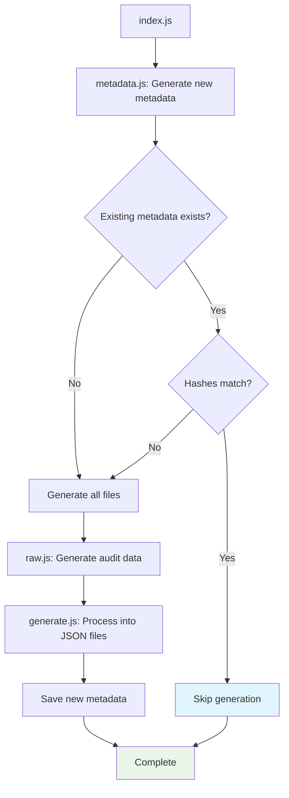

# Codeowners Manifest Scripts

Scripts for generating and caching CODEOWNERS manifest data.

Each of these scripts can be run individually if needed, but `index.js` is most useful because it combines them all.

## Usage

```bash
# Combined script
node index.js     # Generate complete manifest with caching

# Individual scripts
node metadata.js  # Generate metadata with hashes
node raw.js       # Generate raw audit data
node generate.js  # Process raw data into manifest files
```

## Listing a codeowner's tests

`list-tests.mts` resolves the test files owned by a codeowner (via `jest --listTests` against `jest.config.codeowner.js`) and prints one JSON object per test case on stdout — `{ file, startLine, endLine, name }` — without running any test bodies.

```bash
pnpm test:by-codeowner:list '@grafana/dataviz-squad' > dataviz-tests.jsonl
```

Progress and parse failures go to stderr, so stdout stays valid JSONL.

## Control flow of `index.js`



## Default output

By default these scripts will write the following files to the `/codeowners-manifest/*` directory.

- `audit-raw.jsonl` - Raw CODEOWNERS audit data in JSONL format _(for fast stream processing)_
- `teams.json` - List of all codeowners _(for validating codeowner names)_
- `teams-by-filename.json` - Files mapped to their respective codeowners
- `filenames-by-team.json` - Codeowners mapped to their respective files
- `metadata.json` - Hashes for cache validation

## Excluded paths

For a list of excluded paths and filenames, see `jest.config.codeowner.js`.

## Meticulous coverage by team

This report joins Meticulous JavaScript line coverage with the current checkout's
CODEOWNERS manifest. It does not run tests or require a local Grafana instance.

Install the Meticulous CLI yourself (it is not a repository dependency):

```bash
npm install --global @alwaysmeticulous/cli@latest
```

Create a project API token at
[Grafana's Meticulous API tokens page](https://app.meticulous.ai/settings/grafana/projects/grafana/api-tokens).
Set `METICULOUS_API_TOKEN` in your machine's shell configuration, for example in
`~/.zshrc` or `~/.bashrc`, then restart your shell:

```bash
export METICULOUS_API_TOKEN='<your Grafana project API token>'
```

Keep the real token out of the repository. The script passes it through the CLI's
inherited environment; you do not need to provide it with each invocation.
Missing CLI or token produces setup instructions and a nonzero exit status.
Run the installation command again if the CLI reports unsupported options.

```bash
# All Grafana teams, using the project's latest successful coverage
pnpm test:coverage:meticulous:by-codeowner

# One team's total and browsable Monocart report (opens automatically)
pnpm test:coverage:meticulous:by-codeowner '@grafana/dataviz-squad'

# Save a team report without opening the browser
pnpm test:coverage:meticulous:by-codeowner '@grafana/dataviz-squad' --no-open

# A specific test run (can also be combined with a team)
pnpm test:coverage:meticulous:by-codeowner --test-run-id '<run ID>'

# Help requires neither CLI installation nor authentication
pnpm test:coverage:meticulous:by-codeowner --help
```

The command refreshes the cached manifest automatically. It resolves coverage to
one run and fetches every page, including files with zero executed lines. Output
shows the run ID and commit when available. Unavailable coverage fails instead
of producing partial totals.

Coverage is the sum of executed lines divided by the sum of executable lines,
not an average of file percentages. Shared files count fully for every owning
`@grafana/` team; the overall total counts each file once. Files without a Grafana
team, including paths absent from the local manifest, appear in a separate row.

Jest and Meticulous share the source-file filter in `coverage-files.js`. Tests,
mocks, stories, generated files, declarations, graveyard code, scripts, Jest
configs, panel module entrypoints, and all `e2e-playwright/` files (including
helpers and test plugins) are excluded from both reports. Exclusions apply
before calculating team or overall totals and before generating HTML.

Only eligible files returned by Meticulous enter the denominator. Files missing from its
inventory are unknown, not zero-covered. Teams without returned files show
`No coverage data`; files with zero executable lines show `N/A`. The report warns
when Meticulous reports source files it could not parse. Coverage may describe a
different commit from the checkout used for ownership attribution, so these
percentages should not be compared directly with Jest coverage percentages.

Individual team reports are saved under
`coverage/meticulous/by-team/teams/team-grafana-<team>/html/index.html`. The terminal
prints the team total and report URL; the HTML provides a searchable file list
and source-line highlighting. Reports open automatically except when `CI=true`
or `--no-open` is supplied. Teams without coverage data do not generate a report.

The report uses executable and executed line ranges from Meticulous. Only the
Lines metric is shown: the Istanbul adapter represents each executable line as
a synthetic statement, with binary covered/uncovered hits. It does not measure
statement, function, branch, or execution-count coverage.

Source text is loaded from the run's `commitSha` using Git, never from modified
working-tree files. If the commit or source file is unavailable locally, fetch
the run's commit and retry. The script does not fetch Git history automatically.
Ownership still comes from the current checkout. The run and source commit are
shown in the HTML report.

### Testing the Meticulous scripts

The CLI tests use Jest's ESM support with an isolated Node configuration; the
report tests use Node's test runner and generate real Monocart HTML in a temporary
Git repository. Neither suite needs a Meticulous token.

```bash
node --experimental-vm-modules node_modules/jest/bin/jest.js scripts/tests/meticulous-coverage-by-codeowner.test.js --watch=false --runInBand --config '{"testEnvironment":"node","roots":["<rootDir>/scripts/tests"],"transform":{}}'
node --test scripts/tests/meticulous-coverage-report.test.mjs scripts/tests/codeowner-coverage-files.test.mjs
```
