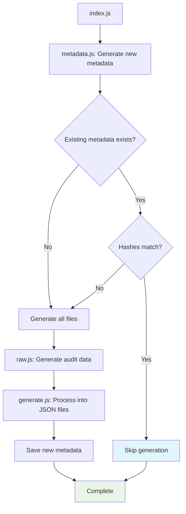

# Codeowners Manifest Scripts

Scripts for generating and caching CODEOWNERS manifest data.

Each of these scripts can be run individually if needed, but `index.js` is most useful because it combines them all.

## Usage

```bash
# Combined script
node index.js     # Generate complete manifest with caching

# Individual scripts
node metadata.js  # Generate metadata with hashes
node raw.js       # Generate raw audit data
node generate.js  # Process raw data into manifest files
```

## Listing a codeowner's tests

`list-tests.mts` resolves the test files owned by a codeowner (via `jest --listTests` against `jest.config.codeowner.js`) and prints one JSON object per test case on stdout — `{ file, startLine, endLine, name }` — without running any test bodies.

```bash
pnpm test:by-codeowner:list '@grafana/dataviz-squad' > dataviz-tests.jsonl
```

Progress and parse failures go to stderr, so stdout stays valid JSONL.

## Control flow of `index.js`



## Default output

By default these scripts will write the following files to the `/codeowners-manifest/*` directory.

- `audit-raw.jsonl` - Raw CODEOWNERS audit data in JSONL format _(for fast stream processing)_
- `teams.json` - List of all codeowners _(for validating codeowner names)_
- `teams-by-filename.json` - Files mapped to their respective codeowners
- `filenames-by-team.json` - Codeowners mapped to their respective files
- `metadata.json` - Hashes for cache validation

## Excluded paths

For a list of excluded paths and filenames, see `jest.config.codeowner.js`.

## Meticulous coverage by team

This report joins Meticulous JavaScript line coverage with the current checkout's
CODEOWNERS manifest. It does not run tests or require a local Grafana instance.

Install the Meticulous CLI yourself (it is not a repository dependency):

```bash
npm install --global @alwaysmeticulous/cli@latest
```

Create a project API token at
[Grafana's Meticulous API tokens page](https://app.meticulous.ai/settings/grafana/projects/grafana/api-tokens).
Set `METICULOUS_API_TOKEN` in your machine's shell configuration, for example in
`~/.zshrc` or `~/.bashrc`, then restart your shell:

```bash
export METICULOUS_API_TOKEN='<your Grafana project API token>'
```

Keep the real token out of the repository. The script passes it through the CLI's
inherited environment; you do not need to provide it with each invocation.
Missing CLI or token produces setup instructions and a nonzero exit status.
Run the installation command again if the CLI reports unsupported options.

```bash
# All Grafana teams, using the project's latest successful coverage
yarn test:coverage:meticulous:by-codeowner

# One team's total and per-file line coverage
yarn test:coverage:meticulous:by-codeowner '@grafana/dataviz-squad'

# A specific test run (can also be combined with a team)
yarn test:coverage:meticulous:by-codeowner --test-run-id '<run ID>'

# Help requires neither CLI installation nor authentication
yarn test:coverage:meticulous:by-codeowner --help
```

The command refreshes the cached manifest automatically. It resolves coverage to
one run and fetches every page, including files with zero executed lines. Output
shows the run ID and commit when available. In-progress or unavailable coverage
fails instead of producing partial totals.

Coverage is the sum of executed lines divided by the sum of executable lines,
not an average of file percentages. Shared files count fully for every owning
`@grafana/` team; the overall total counts each file once. Files without a Grafana
team, including paths absent from the local manifest, appear in a separate row.

Only files returned by Meticulous enter the denominator. Files missing from its
inventory are unknown, not zero-covered. Teams without returned files show
`No coverage data`; files with zero executable lines show `N/A`. The report warns
when Meticulous reports source files it could not parse. Coverage may describe a
different commit from the checkout used for ownership attribution, so these
percentages should not be compared directly with Jest coverage percentages.
